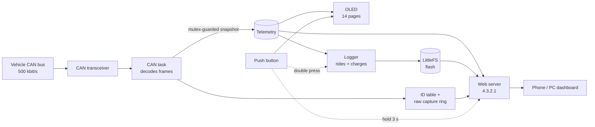

<div align="center">

# ⚡ A-OBD Scanner

**A pocket-sized live dashboard, data logger and CAN tool for your electric scooter.**
Read it on a 0.96" OLED, or on your phone or PC over its own Wi-Fi. Every ride and charge is recorded automatically. No cloud, no app, no internet needed.


<sub>Screenshots use sample data.</sub>

</div>

---

## ✨ What it does

A-OBD listens to the scooter's CAN bus with an ESP32-C3 and turns the raw frames into something you can actually read.

- **📟 On-device OLED**: 14 pages of live data, flipped through with one push button.
- **📱 Phone and PC dashboard**: hold the button for 3 seconds and the scanner starts its own Wi-Fi hotspot. Join it and the dashboard opens by itself. It's laid out for thumbs on a phone and for a wide screen on a PC, with light and dark mode.
- **🔋 Deep battery insight**: SoC, SoH, delta SoC, pack voltage and current, imbalance, and **all 14 cells' voltage, SoH and SoC**.
- **🌡️ BMS details**: cell temperatures, AFE / FET / sense-resistor temperatures, state of energy, EKF SoC, and the BMS's derated current limits.
- **🔌 Charger telemetry**: output and input voltage, current, live power (W/kW), fan speeds, locks and balancing state.
- **🛵 Vehicle data**: drive mode, range, motor RPM, current and temperature, controller temperature, throttle, ambient temperature and humidity, odometer, firmware versions and battery ID, plus every switch, brake, light and indicator.
- **💾 Automatic ride and charge logging**: every session is saved to the scanner's flash with a summary (distance, Wh/km, regen, kWh added, peak temperatures). Open it on your phone as synced charts, zoom in, read every value at any moment, and export CSV.
- **📈 Live chart**: up to 3 signals at once, 4 times a second, for as long as you like.
- **🧪 CAN tools**: see which frames your scooter actually sends, watch every ID's bytes change live, and record a raw capture you can open in SavvyCAN, cantools or python-can.
- **⬆️ Firmware updates over Wi-Fi**: install a new version from your phone, no USB cable needed.
- **🔒 Fully offline**: everything is served straight from the scanner. Nothing leaves the device.

---

## 🖼️ Web dashboard

### On a phone

Four tabs along the bottom, all within thumb reach:

| Tab | What's inside |
|---|---|
| **Home** | SoC ring, range, voltage, drive mode, battery health and every switch |
| **Battery** | A **Cells / BMS / Charger** switch at the top. Cells: pack balance and 14 cell cards (voltage, SoH, SoC). BMS: temperatures, pack estimates, current limits. Charger: power, electricals and status |
| **Vehicle** | Motor, controller and throttle, environment, eco modes and locks, odometer and firmware, and the scanner's firmware update |
| **Data** | A **Live / Logs / CAN** switch: the live chart, saved rides and charges, and the CAN tools |

| Home | Cells | Charger | Vehicle |
|:---:|:---:|:---:|:---:|
|  |  |  |  |

### On a PC

At 1024 px and wider the dashboard switches to a desktop layout. The tab bar moves to the top and every section gets its own page: **Overview · Cells · BMS · Charger · Vehicle · Data**. Cards sit side by side, so each page fits on one screen. For example, all 14 cells show in two rows of seven. Shrink the window and it goes back to the phone layout.

### Design details

- The phone's **back button** moves between tabs and views instead of closing the page.
- The SoC ring turns amber below 30% and red below 15%.
- Cell bars go green, amber or red depending on how far each cell drifts from the pack average.
- A **Live / Offline** pill shows the connection state. If the scanner stops responding, the page dims and recovers on its own when it returns.
- Only the page you're looking at is polled, and polling pauses when the browser tab is in the background.
- Zero external assets. No CDN, no web fonts, no images. The page is stored gzip-compressed (about 26 KB) in flash, and your phone only downloads it again when it changes.

---

## 💾 Ride & charge logging

The scanner records sessions on its own. You don't need to do anything, and the phone doesn't need to be connected.

### What gets recorded

| Session | Starts when | Ends when | Sample rate |
|---|---|---|---|
| **Ride** | the scooter shows any sign of riding: motor RPM, throttle, motor current, pack current above 5 A, or the odometer moving | 30 s after key off (3 min without movement if the scooter doesn't report its key state) | 1 per second |
| **Charge** | the charger is connected | 30 s after it's disconnected | 1 per 10 seconds |

Rides shorter than 30 s and charges shorter than 60 s are discarded. Parked time isn't recorded.

Each sample stores SoC, pack voltage and current, lowest and highest cell voltage, hottest cell temperature, motor RPM, motor current, motor and controller temperature, throttle, drive mode, odometer, charger power, and the brake, charger, balancing, eco, key, high-beam and marker flags.

### Session summary

When a session ends, a summary is saved with it and shown on the OLED for 6 seconds.

- **Ride:** distance, duration, energy used, regen recovered, Wh/km, SoC start → end, peak power, top RPM, max motor / controller / cell temperature, lowest cell voltage.
- **Charge:** energy added (kWh), duration, SoC start → end, peak charging power, max cell temperature, final cell spread.

### Viewing a session (Data → Logs)

- A storage bar showing space used and roughly how many hours of riding are left, plus recording status with an **Add marker** button during a ride.
- A list of sessions with date, distance, Wh/km or kWh added.
- Open a session for:
  - **Stacked charts** on one time axis, up to 4 at once: power, cell min/max, temperatures, SoC, voltage, current, **cell spread**, RPM, throttle, motor current and **energy used so far**.
  - **One crosshair through all of them.** Drag across any chart and the **Values** card shows every recorded value at that moment.
  - **Pinch to zoom, double-tap to reset.** A mouse wheel works on a PC.
  - **An overview strip** of the whole session. Tap or drag it to jump around.
  - **Marker buttons** that jump straight to each marker.
  - **Visible-range stats.** Zoom into any stretch of road and get its distance, energy, Wh/km, regen, average and peak power, lowest cell, max spread and peak temperatures.
- **Download CSV** or delete the session. CSV conversion happens on the phone, so downloads are small and fast.

Charts keep every spike and dip visible, even when a long session has far more points than the screen has pixels.

### Storage and safety

- Logs live in the scanner's own flash using LittleFS. With the default partition scheme there's about 1.5 MB, which is **roughly 12 hours of rides**. A full charge takes only about 50 KB.
- When space runs low, the **oldest session is deleted automatically**.
- Samples are buffered in RAM and written every 30 seconds, so flash wear is negligible. If power is cut, at most the last 30 seconds are lost, and the unfinished session is completed on the next boot.
- The ESP32 has no clock. When you open the dashboard, your phone's time is sent to the scanner and used to date sessions. A session recovered after a power cut may show as *Date unknown*.

### Markers

Double-press the button during a ride, or tap **Add marker** on the Logs page, to flag a moment ("weird noise here"). It shows up as a dashed line on the session charts, as a jump button, and in the `marker` column of the CSV.

---

## 📈 Live chart (Data → Live)

- Pick up to 3 signals: power, cell min/max, temperatures, pack current, voltage, SoC, cell spread, imbalance, RPM, motor current, throttle, charging power and charging current.
- Samples 4 times a second and keeps going until you press **Stop**. Choose a 30 s, 2 min or 5 min window. The last 15 minutes are kept.
- Drag across the charts to read earlier values.
- Every signal is recorded, so you can change what's shown while it runs, and the **CSV** includes all 16 columns.

---

## 🧪 CAN tools (Data → CAN)

### What the scanner sees

A status list of the frames the dashboard depends on, such as motor RPM, motor current, throttle, key and switches, drive mode, odometer, SoC, pack current and charger. Each one shows its update rate, **Stopped**, or **Not seen**. It's the first place to look when a value stays at zero: not every scooter sends every frame on the port you tap.

### All IDs on the bus

Every CAN ID the scanner has received, including extended IDs, with its latest bytes and update rate. Bytes that changed in the last second are highlighted, and IDs the decoder doesn't know are flagged. Twist the throttle and watch which bytes move: that's how new signals get decoded.

### Raw capture

Press **Start** and every frame on the bus is recorded to your phone, for up to 30 minutes per capture. Then download it as:

- **`.log`**, in candump format: opens directly in SavvyCAN, cantools and python-can.
- **`.csv`**, with time, ID, extended / remote flags, length and data bytes.

Frames stream to the phone 4 times a second instead of being written to the scanner's flash. The C3 can't receive CAN frames while it writes to flash, so this way **no frames are lost**. A counter shows anything the CAN controller itself missed. Keep the page open with the screen on while recording.

---

## 📟 On-device OLED

A short press cycles through the pages. A blinking dot in the header means a session is being recorded. While Wi-Fi is on, the screen shows the connection details instead. Plugging in the charger jumps to the Charger page, and unplugging it goes back to where you were.

| # | Page | Shows |
|:-:|---|---|
| 1 | **Battery** | SoC, SoH, delta SoC, voltage, imbalance |
| 2 | **Drive** | Mode, range, motor RPM, motor current, motor temperature |
| 3 | **Controller** | Controller temperature, throttle out, throttle 1 / 3, PDU voltage, ambient temperature and humidity |
| 4 | **Inputs 1** | Key, start, front/rear brake, high beam, horn, kill, storage |
| 5 | **Inputs 2** | Indicators, side stand, display fan, forced/smart eco, seat lock |
| 6 | **Cell voltage** | All 14 cells |
| 7 | **Cell SoH** | All 14 cells |
| 8 | **Cell SoC** | All 14 cells |
| 9 | **Charger** | Out V, out I, in V, power, connected |
| 10 | **Charger 2** | Balancing, fans, locks |
| 11 | **BMS temp** | Cell temps T1–T4, AFE die, FET, ECI, sense resistor |
| 12 | **BMS pack** | Pack current, state of energy, EKF SoC, max SoC, min SoC |
| 13 | **Limits** | Derated discharge / charge / regen current, discharge temp limit, charge cell rule |
| 14 | **Vehicle** | Odometer, BMS hardware, BMS / BCM / gateway / motor firmware, battery ID |
| 📶 | **Wi-Fi** | SSID, password, dashboard address, connected clients |
| 💾 | **Session saved** | Ride or charge summary, shown for 6 s after a session ends |

### 🔘 Button

| Action | Result |
|---|---|
| **Short press** | Next page (when Wi-Fi is off). Also dismisses the session summary |
| **Double press** | Add a marker to the ride being recorded |
| **Hold 3 s** | Toggle Wi-Fi. A progress bar fills along the header while you hold |

Wi-Fi is **off at boot**. Turn it on only when you want the dashboard. Logging runs either way.

---

## 🧰 Hardware

| Part | Notes |
|---|---|
| **ESP32-C3 SuperMini** | Any ESP32 with the built-in CAN (TWAI) controller works; the firmware is tuned for the single-core C3. Default pins are listed below. |
| **CAN transceiver** | A 3.3 V-compatible one, such as an SN65HVD230. The ESP32 only provides the logic-level CAN pins. |
| **0.96" OLED** | SSD1306, 128×64, I²C |
| **Push button** | Momentary, wired between the pin and GND |

### Wiring


```text
 CAN transceiver                ESP32-C3
 ───────────────                ────────
 TXD  ───────────────────────►  GPIO 10   (CAN TX)
 RXD  ◄───────────────────────  GPIO 20   (CAN RX)
 3V3 / GND ──────────────────►  3V3 / GND
 CANH, CANL ─────────────────►  vehicle CAN bus

 OLED (SSD1306, I²C)
 ───────────────────
 SDA  ───────────────────────►  GPIO 6
 SCL  ───────────────────────►  GPIO 7
 VCC / GND ──────────────────►  3V3 / GND

 Push button
 ───────────
 one leg ────────────────────►  GPIO 4    (internal pull-up)
 other leg ──────────────────►  GND
```

All pins are `#define`s at the top of the sketch, so remap them freely.

> **Power and connectors:** how you tap the CAN lines and power the ESP32 depends on your vehicle and your build, and this repo doesn't cover it. Use a proper regulated supply, don't add a termination resistor (the vehicle bus already has one), and double-check your connector pinout before connecting anything.

---

## 🚀 Getting started

### The sketch folder

```text
A_OBD/
├── A_OBD.ino       the firmware
├── page.h          the web page, gzip-compressed (generated - don't edit)
├── index.html      the web page source
└── build_page.py   packs index.html into page.h
```

Keep all four files together. The Arduino IDE ignores the `.html` and `.py` files when compiling, but **the folder must contain only one `.ino` file**, named like the folder.

### First flash (USB)

1. **Install the ESP32 board package** in the Arduino IDE (Boards Manager → *esp32* by Espressif). Version **3.3 or newer** is recommended; it's needed for the automatic sign-in pop-up.
2. **Install the library** `U8g2` from the Library Manager. Everything else (`WiFi`, `WebServer`, `DNSServer`, `Update`, `Wire`, `LittleFS`, the CAN driver) ships with the ESP32 core.
3. **Board settings** (Tools menu):

   | Setting | Value |
   |---|---|
   | Board | *ESP32C3 Dev Module* (or *Nologo ESP32C3 Super Mini*) |
   | Partition Scheme | **Default 4MB with spiffs (1.2MB APP/1.5MB SPIFFS)**. It has room for logs *and* updates over Wi-Fi |
   | USB CDC On Boot | **Enabled**, if you want serial output over USB |

4. **Select the port**, then **Upload**. If the upload doesn't start, hold the **BOOT** button while plugging in USB and try again.
5. Wire everything up and power the device. The welcome screen shows the version (**v6.7**), followed by the live pages.

### Opening the dashboard

1. **Hold the button for 3 seconds.** The OLED shows the Wi-Fi page.
2. On your phone or PC, connect to the Wi-Fi network:

   | | |
   |---|---|
   | **SSID** | `A-OBD` |
   | **Password** | `12345678` |

3. The dashboard opens by itself, or tap the **"Sign in to Wi-Fi network"** notification. If it doesn't, open **http://4.3.2.1**. Any plain-`http` address, like `http://test.com`, gets you there too.
4. If your phone warns that the network has *no internet*, choose to **stay connected**.

> 🔐 **Change the default password** before you ride around with it. Edit `AP_PASS` near the top of the sketch (minimum 8 characters).

### Updating over Wi-Fi

1. In the Arduino IDE: **Sketch → Export Compiled Binary**.
2. Copy **`A_OBD.ino.bin`** from the sketch's `build` folder to your phone. Don't use the file with *merged* in its name.
3. On the dashboard: **Vehicle → Scanner firmware → Choose file → Update**.

The page checks the file before installing: it refuses a merged image, a build for a different chip, or anything that isn't firmware. The update is also refused while the motor is turning. The new firmware only takes over once it has been fully received and verified, so a broken upload leaves the old version running. After the restart, Wi-Fi comes back on by itself and the page reloads.

### Editing the web page

Edit `index.html`, then run:

```bash
python build_page.py
```

That regenerates `page.h`. Compile and upload as usual.

---

## ⚙️ Configuration

Everything you're likely to tweak sits at the top of the sketch.

| Setting | Default | Purpose |
|---|---|---|
| `CAN_TX` / `CAN_RX` | `10` / `20` | CAN transceiver pins |
| `I2C_SDA` / `I2C_SCL` | `6` / `7` | OLED pins |
| `BTN_PIN` | `4` | Push button |
| `LONG_PRESS_MS` | `3000` | Hold time to toggle Wi-Fi |
| `DOUBLE_MS` | `350` | Double-press window for markers |
| `AP_SSID` / `AP_PASS` | `A-OBD` / `12345678` | Hotspot credentials |
| `AP_IP_STR` / `AP_IP` | `4.3.2.1` | Dashboard address |
| `LOG_RIDE_MS` / `LOG_CHARGE_MS` | `1000` / `10000` | Logging sample interval |
| `LOG_END_MS` | `30000` | How long after key off / charger out a session ends |
| `LOG_IDLE_MS` | `180000` | Ride end without movement, when the key state isn't reported |
| `RIDE_PACK_I` | `500` | Pack current (in 0.01 A) that counts as riding |
| `LOG_MIN_RIDE_S` / `LOG_MIN_CHARGE_S` | `30` / `60` | Shorter sessions are discarded |
| `LOG_RESERVE` | `49152` | Flash kept free; the oldest logs are deleted to keep it |
| `PACK_I_SIGN` | `1` | Set to `-1` if "energy used" and "regen" come out swapped |

**Other things worth knowing**

- **CAN speed** is 500 kbit/s (`TWAI_TIMING_CONFIG_500KBITS()`).
- **Why `4.3.2.1`?** Some Android phones ignore sign-in pages on private addresses like `192.168.4.1`, so the pop-up never appears. The public-style address avoids that.
- **Different OLED chip?** If you have an SH1106-based 1.3" panel, swap the `U8G2_SSD1306_128X64_NONAME_F_HW_I2C` constructor for the matching U8g2 one.
- **Wi-Fi range and power:** the hotspot runs at a low TX power (8.5 dBm) with a maximum of 4 clients, so keep the phone close to the device.
- **Passive tap:** the firmware never transmits (TX queue length is 0), but it runs in `TWAI_MODE_NORMAL`, where the controller acknowledges frames in hardware. If you want a strictly silent listener, `TWAI_MODE_LISTEN_ONLY` is the ESP-IDF mode for that. Test it on your own bus first.

---

## 🏗️ How it works



- A dedicated **FreeRTOS task** waits for CAN frames, drains the receive queue in batches and decodes them into a local copy of the telemetry. It publishes that copy under a mutex, so readers never see half-updated data. It also updates the table of every ID seen and, during a raw capture, fills a RAM ring that the phone empties 4 times a second. After each batch it pauses 2 ms so the main loop and Wi-Fi always get CPU time on the single-core C3.
- The **main loop** handles the button, runs the logger every 200 ms, redraws the OLED (4 Hz normally, 1–2 Hz while Wi-Fi is on), answers DNS for the sign-in pop-up and serves HTTP.
- **Numbers are formatted with integer math.** The C3 has no hardware floating point, so the OLED and JSON output avoid `float` printing entirely.
- JSON is built in one static buffer: no `String`, no heap churn. Charts, log parsing and CSV conversion all run on the phone, not the scanner.
- A `[DIAG]` line prints to the serial monitor (115200 baud) every 5 seconds with missed/overrun frame counts, largest batch and free heap. `[LOG]`, `[WIFI]` and `[HTTP]` lines report the filesystem, the hotspot and each request.

### HTTP endpoints

| Endpoint | Returns |
|---|---|
| `GET /` | The dashboard (gzip-compressed single page, with an ETag) |
| `GET /d` | Home: battery summary, drive mode, range, switches, lights |
| `GET /c` | Cells: 14 voltages (`v`), SoH (`h`), SoC (`s`), max/min cell SoH |
| `GET /g` | Charger: electricals, power, balancing, fans, locks |
| `GET /b` | BMS: temperatures, pack current, SoE / SoC estimates, current limits |
| `GET /m` | Vehicle: motor, controller, throttle, environment, eco modes, seat lock, odometer, firmware, battery ID, scanner version |
| `GET /live` | Every live-chart signal in one small reply |
| `GET /logs` | Storage use, recording state and the summary of every saved session |
| `GET /log?id=N` | One session as the raw binary file (parsed by the page) |
| `GET /logdel?id=N` | Delete one session (`id=all` deletes everything except the one recording) |
| `GET /time?t=UNIX` | Sets the clock from the phone (sent automatically by the page) |
| `GET /mark` | Adds a marker to the ride being recorded |
| `GET /canids` | Every CAN ID seen: ID, extended flag, frame count, ms since last, length, data |
| `GET /rawstart` | Starts a raw capture |
| `GET /rawpull` | Frames captured since the last pull (binary); `?stop=1` ends the capture |
| `POST /update?size=N` | Firmware upload |
| `GET /capport` | Captive Portal API answer (RFC 8908), announced to phones over DHCP |

Any other address redirects to the dashboard. That's what makes the sign-in pop-up work.

<details>
<summary><b>Example responses</b></summary>

`/d`
```json
{"soc":78.45,"soh":96.20,"bdelta":0.35,"volt":54.82,"imb":0.0123,"range":112,
 "mode":"SPORTS","key":true,"kill":false,"storage":false,"stand":false,"dfan":true,
 "start":false,"fbrake":false,"rbrake":true,"horn":false,"hbeam":true,
 "indl":true,"indr":false,"indc":false}
```

`/c`
```json
{"v":[3.9123,3.9140,3.9101,3.9155,3.9132,3.9098,3.9040,3.9144,3.9150,3.9120,3.9133,3.9127,3.9161,3.8760],
 "h":[98,97,96,98,95,94,89,97,98,96,97,95,92,68],
 "s":[78.10,78.40,77.90,78.60,78.20,77.80,76.90,78.30,78.50,78.00,78.20,78.10,78.70,74.20],
 "maxS":96.20,"minS":68.00}
```

`/live`
```json
{"soc":78.20,"V":57.93,"I":25.70,"P":1488,"cmin":3.8110,"cmax":3.8380,"spr":27.0,
 "imb":0.0150,"ct":34.80,"mt":56,"ctt":47,"rpm":2927,"mi":25.7,"thr":19,"cw":0.0,"ca":0.00}
```

`/canids`
```json
{"tot":48210,"miss":0,"full":0,"raw":0,
 "ids":[[305,0,3600,12,8,"2B2C2D2E2F303132"],[419385573,1,1200,40,6,"404142434445"]]}
```

`/logs`
```json
{"used":163840,"total":1507328,"pis":1,"rec":{"on":0,"ty":0,"id":0,"du":0,"n":0},
 "s":[{"id":12,"ty":1,"ep":1761380000,"du":1834,"n":1834,"di":14200,"wu":4120,"wr":310,
       "wc":0,"s0":8400,"s1":6150,"mt":71,"ct":58,"cl":3410,"mc":37210,"rp":5200,
       "pw":4480,"sp":180,"mk":1}]}
```
In `/logs`, values are raw units: `wu`/`wr`/`wc` are Wh × 10, `s0`/`s1` are SoC × 100, `cl` is °C × 100, `mc`/`sp` are volts × 10 000, `di` is metres.
</details>

<details>
<summary><b>Log file format</b></summary>

Each session is stored as `/l/NNNNN.bin`: a 64-byte header followed by 32-byte records, all little-endian.

**Header**: magic `AOBD`, version, type (1 = ride, 2 = charge), done flag, start time (Unix, 0 = unknown), duration, record count, distance, Wh used / regen / charged (× 10), SoC start/end, max motor / controller / cell temperature, lowest cell voltage, top RPM, peak power, final cell spread, marker count.

**Record** (32 bytes):

| Offset | Type | Field | Unit |
|---|---|---|---|
| 0 | u32 | time since session start | 0.1 s |
| 4 | u16 | SoC | 0.01 % |
| 6 | u16 | pack voltage | 0.01 V |
| 8 | i16 | pack current | 0.01 A |
| 10 | u16 | lowest cell voltage | 0.1 mV |
| 12 | u16 | highest cell voltage | 0.1 mV |
| 14 | i16 | hottest cell (T1–T4) | 0.01 °C |
| 16 | i16 | motor RPM | rpm |
| 18 | i16 | motor current | 0.1 A |
| 20 | i8 | motor temperature | °C |
| 21 | i8 | controller temperature | °C |
| 22 | i8 | throttle | % |
| 23 | u8 | drive mode | raw |
| 24 | u32 | odometer | m |
| 28 | u16 | flags | bit 0 front brake, 1 rear brake, 2 charger, 3 balancing, 4 forced eco, 5 smart eco, 6 key, 7 marker, 8 high beam |
| 30 | u16 | charger output power | W |
</details>

<details>
<summary><b>Raw capture format</b></summary>

`/rawpull` returns a 16-byte header (`u32` frames, frames dropped, ring size, frames missed by the CAN controller) followed by 16-byte frames:

| Offset | Type | Field |
|---|---|---|
| 0 | u32 | bits 0–27: time since start in 10 µs units (wraps every ~44.7 min; the page unwraps it), bits 28–31: data length |
| 4 | u32 | bits 0–28: CAN ID, bit 29: remote frame, bit 30: extended ID |
| 8 | u8[8] | data bytes |

The page converts this to candump `.log` lines such as `(1761660000.001000) can0 131#0001020304050607`.
</details>

### CAN frames read

| ID | Data |
|---|---|
| `0x101` | Drive mode, smart eco, forced eco |
| `0x102` | Brakes, high beam, start / kill / storage switches, horn, indicators, key, side stand, PDU voltage |
| `0x103` | Seat lock, charger locks |
| `0x107` | BCM firmware version |
| `0x131` | SoC, balancing, charger connected |
| `0x132`–`0x135` | Cell voltages 1–14 (`0x135` also AFE die temperature and pack current) |
| `0x136`, `0x137` | Cell temperatures 1–5, FET / ECI / sense-resistor temperatures |
| `0x139` | Derated discharge, charge and regen current |
| `0x13D` | Delta SoC |
| `0x140` | Humidity, ambient temperature, EKF SoC |
| `0x141` | Pack voltage, imbalance |
| `0x142` | Min V1 / V2 estimates, min SoC estimate, discharge temperature limit |
| `0x143`–`0x146` | Cell SoC 1–14 (`0x146` also max SoC) |
| `0x148` | Charge algorithm currents |
| `0x14D` | State of health, max / min cell SoH |
| `0x14E`, `0x14F` | Cell SoH 1–14 |
| `0x151` | State of energy |
| `0x162` | BMS hardware and firmware version |
| `0x163`, `0x164` | Battery ID |
| `0x18C` | Motor current, motor and controller temperature |
| `0x200` | Range, display fan |
| `0x201` | Charger output voltage and current |
| `0x203` | Charger input voltage |
| `0x208` | Charger fan speeds |
| `0x212` | Odometer |
| `0x216` | Gateway firmware version |
| `0x38C` | Throttle out, throttle 1, throttle 3 |
| `0x510` | Motor RPM |
| `0x70B` | Motor firmware version |

Not every model sends all of these on the diagnostic port. **Data → CAN** shows which ones your scooter does.

---

## 🛠️ Troubleshooting

| Symptom | Try this |
|---|---|
| **"redefinition of …" or "'LogHdr' has not been declared" when compiling** | The sketch folder has more than one `.ino` file, and the Arduino IDE joins them all together. Keep only `A_OBD.ino` in the `A_OBD` folder. |
| **`exec: "cmd": executable file not found in %PATH%`** (Windows) | Your PATH is missing `C:\Windows\System32`. Add `%SystemRoot%\system32` back under System variables → Path, then restart the IDE. |
| **"Sketch too big"** | Use the **Default 4MB with spiffs** partition scheme. **No OTA (2MB APP/2MB SPIFFS)** also fits, but disables updates over Wi-Fi. |
| **Logs page says storage isn't available** | The partition scheme has no SPIFFS/LittleFS area. Pick one of the schemes above and upload again. |
| **Rides aren't being logged** | Open **Data → CAN → What the scanner sees**. A ride needs at least one riding signal (RPM, throttle, motor current, pack current or odometer). If they all show *Not seen*, record a raw capture while you twist the throttle and look for the bytes that change. |
| **RPM, throttle or motor values stay at zero** | Your scooter may not send those frames on the port you tapped, or may send them on different IDs. Check **Data → CAN**. |
| **The dashboard doesn't pop up when joining Wi-Fi** | Forget the `A-OBD` network and reconnect. On Android, look for the "Sign in to Wi-Fi network" notification, and set **Private DNS** to *Automatic*. Use ESP32 core 3.3 or newer. Opening `http://4.3.2.1` always works. |
| **Phone still shows the old dashboard** | Check the OLED welcome screen shows the new version, then reload the page. |
| **Firmware update is refused** | Pick `A_OBD.ino.bin`, not the *merged* file. Check the board selected in the IDE is the ESP32-C3, and stop the scooter. |
| **"Energy used" is tiny and "Regen" is large** | Your BMS reports current with the opposite sign. Set `PACK_I_SIGN` to `-1`. |
| **Left and right indicators are swapped** | Swap bits 0 and 1 for frame `0x102` in `applyFrame`. |
| **All values are zero** | Check CANH/CANL, the transceiver's 3.3 V supply, and that the vehicle is awake. Open the serial monitor at 115200 and watch the `[DIAG]` line, or **Data → CAN**. |
| **OLED is blank** | Check SDA/SCL and power. Confirm it's an I²C SSD1306 at the default address. |
| **Can't find the `A-OBD` network** | Hold the button for the full 3 seconds. The OLED must show the Wi-Fi page. |
| **Dashboard says Offline** | You've drifted out of range, or Wi-Fi was turned off with the button. It reconnects by itself. |
| **Raw capture shows lost frames** | The phone stopped collecting, for example because the screen turned off or it went out of range. Keep the page open and stay close. |
| **`rx_missed` slowly goes up in `[DIAG]`** | Normal. Writing logs to flash briefly pauses the C3 every 30 s and a few frames are skipped. Values refresh within a second. |

---

## 📝 Changelog

### v6.7
- **PC layout**: at 1024 px and wider, the dashboard has a top tab bar with separate Overview, Cells, BMS, Charger, Vehicle and Data pages, each laid out to fit one screen. The phone layout is unchanged.

### v6.5
- **Ride logging no longer depends on motor RPM**: rides start on any riding signal (RPM, throttle, motor current, pack current or odometer).
- **CAN tools**: a key-signal status list, a live table of every ID on the bus, and raw capture to `.log` (candump) / `.csv`.

### v6.4
- **New charts**: stacked synced charts with a full values readout, pinch / drag / double-tap zoom, an overview strip, marker shortcuts, visible-range stats, and cell spread and cumulative energy signals.
- **Spike-preserving drawing** and round axis ticks.
- **Live chart**: up to 3 signals, 4 samples a second, a rolling window, tap to read, and all 16 signals in the CSV.

### v6.1 – v6.3
- **Firmware updates over Wi-Fi**, with file checks and automatic reconnect.
- **The dashboard opens by itself** when you join the Wi-Fi, using the captive portal and the RFC 8908 / 8910 announcement. The dashboard moved to `4.3.2.1`.
- **The OLED jumps to the Charger page** while charging.
- **The web page is stored gzip-compressed** (about 4× smaller) with an ETag, so phones never show an outdated page.

### v6
- **Ride and charge data logging** to flash, with automatic start/stop, power-loss recovery, session summaries, markers and CSV export.
- **Extended decoding**: per-cell SoC, cell and BMS temperatures, pack current, state of energy, SoC estimates, current limits, controller temperature, throttle, PDU voltage, ambient temperature and humidity, odometer, firmware versions and battery ID.
- **Live chart** with CSV export.
- **OLED**: 8 → 14 pages, a recording indicator, a session summary screen, and double-press for markers.
- **Dashboard**: reorganised into Home / Battery / Vehicle / Data, with a working phone back button.
- **Tuned for the ESP32-C3**: integer-only number formatting, a CAN task that yields to Wi-Fi, small per-tab JSON endpoints, and no heap allocation when serving data.

### v4
- Redesigned mobile-first dashboard with dark mode, OLED display and push-button control.

---

## ⚠️ Disclaimer

This is a hobby project, provided as is. It is **not affiliated with, endorsed by, or supported by Ather Energy**. Connecting to a vehicle's CAN bus is done at your own risk and may affect your warranty. Never interact with the device while riding.

---

## 🙏 Acknowledgments & Attribution

This project stands on the shoulders of the original [**ATHER-OBD-READER**](https://github.com/SAM0-0/ATHER-OBD-READER) by [**@SAM0-0**](https://github.com/SAM0-0). That project laid the groundwork for everything underneath: reading the CAN bus, decoding the vehicle's data, and the core OBD functionality. Without it, this one wouldn't exist.

The extended signal decoding added in v6 (BMS temperatures and estimates, current limits, cell SoC, controller and throttle data, environment, odometer and firmware versions) comes from the **A OBD Scanner v5** build by **the community and @SAM0-0**.

### What I added

- 🎨 **A completely redesigned web dashboard and interface**, built mobile-first with a light theme, a dark mode and a desktop layout.
- 📟 **A 0.96" OLED display** for monitoring right on the device.
- 🔘 **A physical push button** for local control: page switching, Wi-Fi toggle and log markers.
- 💾 **Ride and charge data logging** with session summaries, synced charts and CSV export.
- 🧪 **CAN tools**: bus explorer and raw capture.
- ⬆️ **Firmware updates over Wi-Fi** and the automatic sign-in pop-up.
- ⚡ **Optimisation for the ESP32-C3 SuperMini.**
- 🔧 **Adapting the original implementation** so the new hardware and interface fit together.

The vehicle data and decoding logic are still based on the original work, and all credit for that foundation belongs to its authors.

📦 **Original repository:** https://github.com/SAM0-0/ATHER-OBD-READER
Please head there for the upstream implementation and its license.
