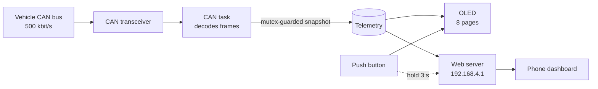

<div align="center">

# ⚡ A-OBD Scanner

**A pocket-sized live dashboard for your electric scooter's CAN bus.**
Read it on a 0.96" OLED, or on your phone over its own Wi-Fi. No cloud, no app, no internet needed.


<sub>Screenshots use sample data.</sub>

</div>

---

## ✨ What it does

A-OBD listens to the vehicle's CAN bus with an ESP32 and turns the raw frames into something you can actually read.

- **📟 On-device OLED**: 8 pages of live data, flipped through with one push button.
- **📱 Phone dashboard**: hold the button for 3 seconds and the ESP32 starts its own Wi-Fi hotspot. Open one address and you get a premium, touch-friendly dashboard.
- **🔋 Deep battery insight**: SoC, SoH, delta SoC, pack voltage, imbalance, and **all 14 cell voltages and cell SoH values**.
- **🔌 Charger telemetry**: output and input voltage, current, live power (W/kW), fan speeds, locks and balancing state.
- **🛵 Ride data**: drive mode, range, motor RPM, motor current and temperature, plus every switch, brake, light and indicator.
- **🌗 Light-first design with dark mode**: easy-to-read values, big numerals, and a toggle for dark mode.
- **🔒 Fully offline**: the dashboard is served straight from the ESP32. Nothing leaves the device.

---

## 🖼️ Web dashboard

Designed mobile-first, since that's where it's used.

| Dashboard | Cells | Charger | More |
|:---:|:---:|:---:|:---:|
|  |  |  |  |
| SoC ring, range, voltage, mode, battery health and every switch | Pack balance summary and 14 cell cards with voltage, health and balance bar | Charging power, in/out electricals and charger status | Motor stats, eco modes and seat lock |

**Design details**

- A bottom tab bar keeps everything within thumb reach.
- The SoC ring turns amber below 30% and red below 15%.
- Cell bars go green, amber or red depending on how far each cell drifts from the pack average.
- A **Live / Offline** pill shows the connection state. If the ESP stops responding, the page dims and recovers on its own when it returns.
- Polling pauses when the browser tab is in the background, which keeps the load on the ESP low.
- Zero external assets. No CDN, no web fonts, no images. The whole page (about 20 KB) lives in flash, so it works on a hotspot with no internet.

---

## 📟 On-device OLED

A short press cycles through the pages. While Wi-Fi is on, the screen shows the connection details instead.

| # | Page | Shows |
|:-:|---|---|
| 1 | **Battery** | SoC, SoH, delta SoC, voltage, imbalance |
| 2 | **Drive** | Mode, range, motor RPM, motor current, motor temperature |
| 3 | **Inputs 1** | Key, start, front/rear brake, high beam, horn, kill, storage |
| 4 | **Inputs 2** | Indicators, side stand, display fan, forced/smart eco, seat lock |
| 5 | **Cell voltage** | All 14 cells |
| 6 | **Cell SoH** | All 14 cells |
| 7 | **Charger** | Out V, out I, in V, power, connected |
| 8 | **Charger 2** | Balancing, fans, locks |
| 📶 | **Wi-Fi** | SSID, password, IP, connected clients |

### 🔘 Button

| Action | Result |
|---|---|
| **Short press** | Next page (when Wi-Fi is off) |
| **Hold 3 s** | Toggle Wi-Fi. A progress bar fills along the header while you hold |

Wi-Fi is **off at boot**. Turn it on only when you want the phone dashboard.

---

## 🧰 Hardware

| Part | Notes |
|---|---|
| **ESP32 board** | Needs the built-in CAN (TWAI) controller. Default pins are listed below. |
| **CAN transceiver** | A 3.3 V-compatible one, such as an SN65HVD230. The ESP32 only provides the logic-level CAN pins. |
| **0.96" OLED** | SSD1306, 128×64, I²C |
| **Push button** | Momentary, wired between the pin and GND |

### Wiring

```text
 CAN transceiver                ESP32
 ───────────────                ─────
 TXD  ───────────────────────►  GPIO 10   (CAN TX)
 RXD  ◄───────────────────────  GPIO 20   (CAN RX)
 3V3 / GND ──────────────────►  3V3 / GND
 CANH, CANL ─────────────────►  vehicle CAN bus

 OLED (SSD1306, I²C)
 ───────────────────
 SDA  ───────────────────────►  GPIO 6
 SCL  ───────────────────────►  GPIO 7
 VCC / GND ──────────────────►  3V3 / GND

 Push button
 ───────────
 one leg ────────────────────►  GPIO 4    (internal pull-up)
 other leg ──────────────────►  GND
```

All pins are `#define`s at the top of the sketch, so remap them freely.

> **Power and connectors:** how you tap the CAN lines and power the ESP32 depends on your vehicle and your build, and this repo doesn't cover it. Use a proper regulated supply and double-check your connector pinout before connecting anything.

---

## 🚀 Getting started

1. **Install the ESP32 board package** in the Arduino IDE (Boards Manager → *esp32* by Espressif).
2. **Install the library** `U8g2` from the Library Manager. Everything else (`WiFi`, `WebServer`, `Wire`, the CAN driver) ships with the ESP32 core.
3. **Open the sketch.** Keep the file as `A_OBD/A_OBD.ino`, since the Arduino IDE expects the folder and the file to share a name.
4. **Select your board and port**, then **Upload**.
5. Wire everything up and power the device. The welcome screen appears, followed by the live pages.

### Opening the dashboard

1. **Hold the button for 3 seconds.** The OLED shows the Wi-Fi page.
2. On your phone, connect to the Wi-Fi network:

   | | |
   |---|---|
   | **SSID** | `A-OBD` |
   | **Password** | `12345678` |

3. Open **http://192.168.4.1** in your browser (plain `http`, not `https`).
4. If your phone warns that the network has *no internet*, choose to **stay connected**.

> 🔐 **Change the default password** before you ride around with it. Edit `AP_PASS` near the top of the sketch (minimum 8 characters).

---

## ⚙️ Configuration

Everything you're likely to tweak sits at the top of the sketch.

| Setting | Default | Purpose |
|---|---|---|
| `CAN_TX` / `CAN_RX` | `10` / `20` | CAN transceiver pins |
| `I2C_SDA` / `I2C_SCL` | `6` / `7` | OLED pins |
| `BTN_PIN` | `4` | Push button |
| `LONG_PRESS_MS` | `3000` | Hold time to toggle Wi-Fi |
| `AP_SSID` / `AP_PASS` | `A-OBD` / `12345678` | Hotspot credentials |

**Other things worth knowing**

- **CAN speed** is 500 kbit/s (`TWAI_TIMING_CONFIG_500KBITS()`).
- **Different OLED chip?** If you have an SH1106-based 1.3" panel, swap the `U8G2_SSD1306_128X64_NONAME_F_HW_I2C` constructor for the matching U8g2 one.
- **Wi-Fi range and power:** the hotspot runs at a low TX power (8.5 dBm) with a maximum of 4 clients, so keep the phone close to the device.
- **Passive tap:** the firmware never transmits (TX queue length is 0), but it runs in `TWAI_MODE_NORMAL`, where the controller acknowledges frames in hardware. If you want a strictly silent listener, `TWAI_MODE_LISTEN_ONLY` is the ESP-IDF mode for that. Test it on your own bus first.

---

## 🏗️ How it works



- A dedicated **FreeRTOS task** drains the CAN receive queue and decodes frames into a local copy of the telemetry. It publishes that copy under a mutex only when the queue goes quiet, so readers never see half-updated data.
- The **main loop** handles the button, redraws the OLED (4 Hz normally, 1 Hz while Wi-Fi is on) and serves HTTP.
- The dashboard polls small JSON endpoints, only for the tab you're looking at.
- A `[DIAG]` line prints to the serial monitor (115200 baud) every 5 seconds with missed/overrun frame counts, queue backlog and free heap. That's handy when debugging the bus connection.

### HTTP endpoints

| Endpoint | Returns |
|---|---|
| `GET /` | The dashboard (single self-contained HTML page) |
| `GET /data` | Battery, drive mode, range, RPM, switches, lights, eco modes |
| `GET /cells` | 14 cell voltages (`v`) and 14 cell SoH values (`h`) |
| `GET /charger` | Charger electricals and status, motor current/temp, locks |

<details>
<summary><b>Example responses</b></summary>

`/data`
```json
{"soc":78.45,"soh":96.20,"bdelta":0.35,"volt":54.82,"imb":0.0123,"rpm":3120,
 "mode":"SPORTS","range":112,"fbrake":false,"rbrake":true,"hbeam":true,
 "start":false,"kill":false,"storage":false,"horn":false,"indl":true,
 "indr":false,"indc":false,"key":true,"stand":false,"dfan":true,
 "feco":false,"seco":true}
```

`/cells`
```json
{"v":[3.9123,3.9140,3.9101,3.9155,3.9132,3.9098,3.9040,3.9144,3.9150,3.9120,3.9133,3.9127,3.9161,3.8760],
 "h":[98,97,96,98,95,94,89,97,98,96,97,95,92,68]}
```

`/charger`
```json
{"coutv":58.400,"couti":9.820,"cinv":231.500,"mbi":-12.4,"mt":47,"bal":1,
 "watts":573.50,"fan1":2400,"fan2":2380,"cconnected":true,"seat":true,
 "clock1":true,"clock2":false}
```
</details>

### CAN frames read

| ID | Data |
|---|---|
| `0x101` | Drive mode, smart eco, forced eco |
| `0x102` | Brakes, high beam, start / kill / storage switches, horn, indicators, key, side stand |
| `0x103` | Seat lock, charger locks |
| `0x131` | SoC, balancing, charger connected |
| `0x132`–`0x135` | Cell voltages 1–14 |
| `0x13D` | Delta SoC |
| `0x141` | Pack voltage, imbalance |
| `0x14D` | State of health |
| `0x14E`, `0x14F` | Cell SoH 1–14 |
| `0x18C` | Motor current and temperature |
| `0x200` | Range, display fan |
| `0x201` | Charger output voltage and current |
| `0x203` | Charger input voltage |
| `0x208` | Charger fan speeds |
| `0x510` | Motor RPM |

---

## 🛠️ Troubleshooting

| Symptom | Try this |
|---|---|
| **All values are zero** | Check CANH/CANL, the transceiver's 3.3 V supply, and that the vehicle is awake. Open the serial monitor at 115200 and watch the `[DIAG]` line. |
| **OLED is blank** | Check SDA/SCL and power. Confirm it's an I²C SSD1306 at the default address. |
| **Can't find the `A-OBD` network** | Hold the button for the full 3 seconds. The OLED must show the Wi-Fi page. |
| **Page won't load** | Use `http://192.168.4.1` (not `https`), and stay connected even though the phone says there's no internet. |
| **Dashboard says Offline** | You've drifted out of range, or Wi-Fi was turned off with the button. It reconnects by itself. |

---

## ⚠️ Disclaimer

This is a hobby project, provided as is. It is **not affiliated with, endorsed by, or supported by Ather Energy**. Connecting to a vehicle's CAN bus is done at your own risk and may affect your warranty. Never interact with the device while riding.

---

## 🙏 Acknowledgments & Attribution

This project stands on the shoulders of the original [**ATHER-OBD-READER**](https://github.com/SAM0-0/ATHER-OBD-READER) by [**@SAM0-0**](https://github.com/SAM0-0). That project laid the groundwork for everything underneath: reading the CAN bus, decoding the vehicle's data, and the core OBD functionality. Without it, this one wouldn't exist.

### What I added

- 🎨 **A completely redesigned web dashboard and interface**, built mobile-first with a light theme and a dark mode.
- 📟 **A 0.96" OLED display** for monitoring right on the device.
- 🔘 **A physical push button** for local control: page switching, plus the hold-to-toggle Wi-Fi.
- 🔧 **Adapting the original implementation** so the new hardware and interface fit together.

The vehicle data and decoding logic are still based on the original work, and all credit for that foundation belongs to its author.

📦 **Original repository:** https://github.com/SAM0-0/ATHER-OBD-READER
Please head there for the upstream implementation and its license.
